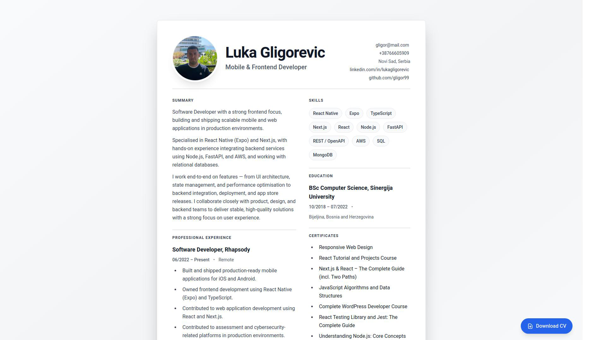

# Modern Resume/CV Template

A beautiful, modern, and fully responsive resume/CV template built with HTML and Tailwind CSS. Perfect for developers, designers, and professionals who want a clean, professional online resume.

## 📸 Preview



> **Note:** This is a template. Replace all placeholder content (marked with "Your Name", "Your Job Title", etc.) with your own information.

## ✨ Features

- 🎨 **Modern Design** - Clean, professional paper-like design with subtle shadows and gradients
- 📱 **Fully Responsive** - Looks great on mobile, tablet, and desktop
- 🖨️ **Print-Friendly** - Optimized for printing and PDF export
- ♿ **Accessible** - WCAG compliant with proper ARIA labels and keyboard navigation
- 🔍 **SEO Optimized** - Complete meta tags, Open Graph, Twitter Cards, and structured data (JSON-LD)
- 🚀 **Fast** - Lightweight, no dependencies (except Tailwind CDN)
- 📄 **PDF Download** - Easy PDF download functionality
- 🎯 **Semantic HTML** - Proper HTML5 semantic elements

## 🚀 Quick Start

1. **Clone or download this repository**

   ```bash
   git clone https://github.com/gligor99/resume-template.git
   cd resume-template
   ```

2. **Customize your information**

   - Edit `data.json` and update all your information:
     - Personal information (name, job title, contact details)
     - Social links (LinkedIn, GitHub)
     - Summary paragraphs
     - Work experience (you can add multiple entries)
     - Projects (you can add as many as you want)
     - Skills (add or remove skills as needed)
     - Education
     - Certificates
   - After editing `data.json`, run one of these commands to update `index.html`:

     ```bash
     # Using Python (recommended)
     python3 update.py

     # Or using Node.js
     node update.js
     ```

     This updates `index.html` with your changes.

   - Add your profile photo to `assets/images/profile.jpg` (recommended size: 400x400px)
   - Add your PDF resume to `assets/resume/your-resume.pdf` (optional)

3. **Update meta tags and structured data**

   - Update the `meta` section in `data.json` with your website URL
   - All meta tags and structured data are automatically generated from `data.json`
   - Don't forget to run `python3 update.py` or `node update.js` after changes

4. **View your resume**

   Simply open `index.html` in your browser. No server needed!

5. **Deploy**
   - Deploy to Vercel, Netlify, GitHub Pages, or any static hosting

## 📁 Project Structure

```
resume-template/
├── assets/
│   ├── images/
│   │   └── profile.jpg          # Your profile photo (add your own)
│   └── resume/
│       └── your-resume.pdf       # Optional PDF resume (add your own)
├── data.json                     # All resume data (edit this!)
├── index.html                    # Main HTML file (updated by update script)
├── update.py                     # Python script to update HTML from JSON
├── update.js                     # Node.js script to update HTML from JSON
├── preview.png                   # Preview image of the template
└── README.md                     # This file
```

## 🎨 Customization

### Data-Driven Approach

This template is fully data-driven through `data.json`. Simply edit the JSON file to update all content:

- **Multiple Projects**: Add as many projects as you want to the `projects` array
- **Multiple Experience Entries**: Add multiple work experiences to the `experience` array
- **Skills**: Easily add or remove skills from the `skills` array
- **Education**: Add multiple education entries if needed

After editing `data.json`, run `python3 update.py` or `node update.js` to update the HTML. The JSON data is embedded directly in the HTML, so the resume works when opened directly from the file system (no server needed).

**Choose your preferred tool:**

- **Python**: `python3 update.py` (works if you have Python 3 installed)
- **Node.js**: `node update.js` (works if you have Node.js installed)

Both scripts do the same thing - embed your JSON data into the HTML file.

### Colors

The template uses Tailwind CSS utility classes. You can customize colors by:

- Replacing `gray-*` classes with your preferred color scheme
- Modifying the gradient background in the body tag
- Adjusting border and text colors

### Layout

- Modify the grid layout in the `<main>` section
- Adjust spacing using Tailwind spacing utilities
- Customize section headers and typography

### Sections

All sections are automatically generated from `data.json`. To customize:

- Edit the JSON structure in `data.json`
- Modify the rendering functions in `index.html` if you need different HTML structure

## 📝 Sections Included

- ✅ Header with profile photo and contact info
- ✅ Professional Summary
- ✅ Work Experience
- ✅ Projects
- ✅ Skills (with pill-style tags)
- ✅ Education
- ✅ Certificates

## 🔧 Technical Details

- **HTML5** - Semantic markup
- **Tailwind CSS** - Utility-first CSS framework (via CDN)
- **Structured Data** - JSON-LD schema.org markup
- **Print Styles** - Custom CSS for print/PDF optimization
- **Data Management** - JSON-driven content with Python or Node.js update scripts

## 📦 Update Scripts

This template includes two update scripts that do the same thing - embed `data.json` into `index.html`:

- **`update.py`** - Python 3 script (no dependencies required)
- **`update.js`** - Node.js script (no dependencies required)

**Usage:**

```bash
# Using Python
python3 update.py

# Or using Node.js
node update.js
```

Both scripts will:

1. Read `data.json`
2. Embed the data into `index.html` as a JavaScript object
3. Update the HTML file

Choose whichever tool you prefer or have installed on your system!

## 📄 License

This project is open source and available under the [MIT License](LICENSE).

## 🤝 Contributing

Contributions, issues, and feature requests are welcome! Feel free to check the [issues page](https://github.com/gligor99/resume-template/issues).

## ⭐ Show Your Support

If you find this template useful, please give it a ⭐ on GitHub!

## 📧 Contact

Luka Gligorevic - [@lukagligorevic](https://www.linkedin.com/in/lukagligorevic)

Project Link: [https://github.com/gligor99/resume-template](https://github.com/gligor99/resume-template)

---

Made with ❤️ by [gligor99](https://github.com/gligor99)
